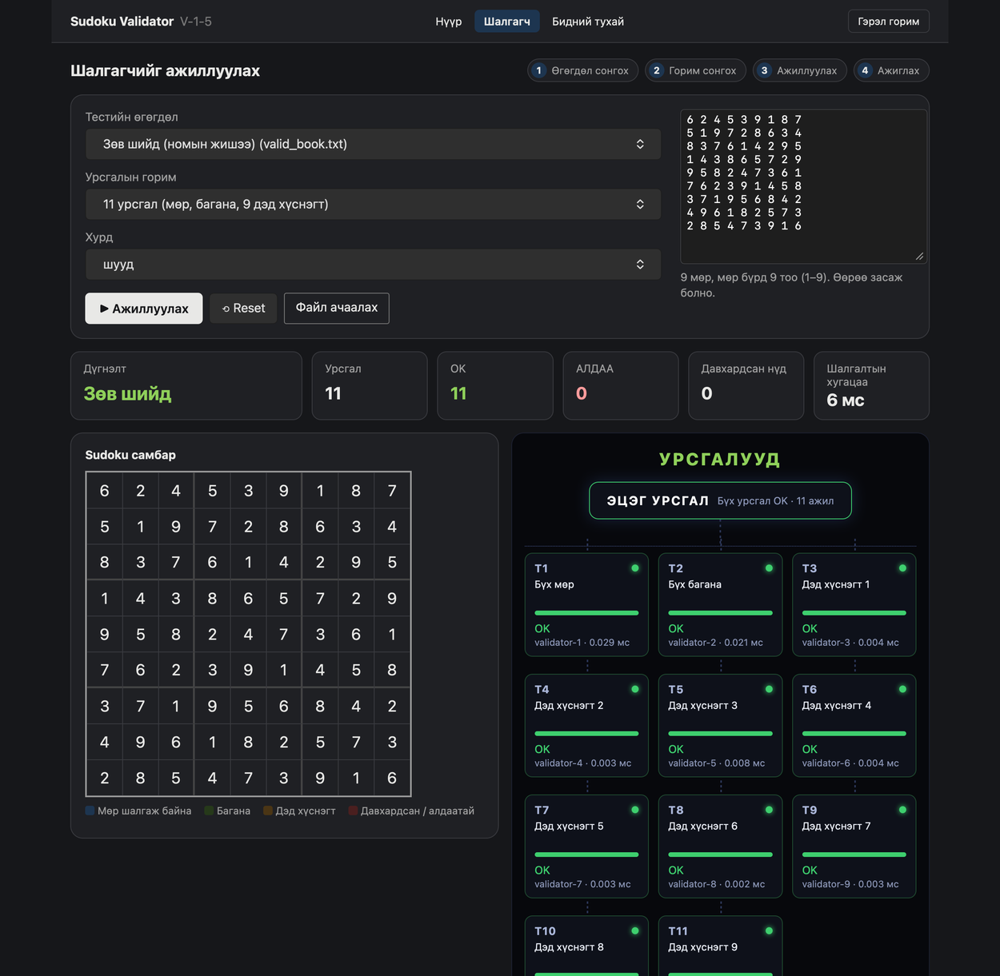
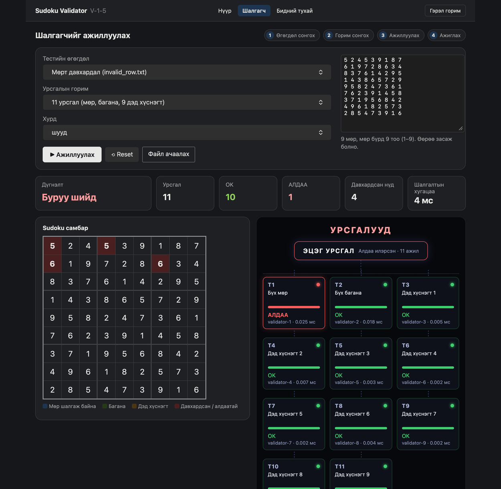
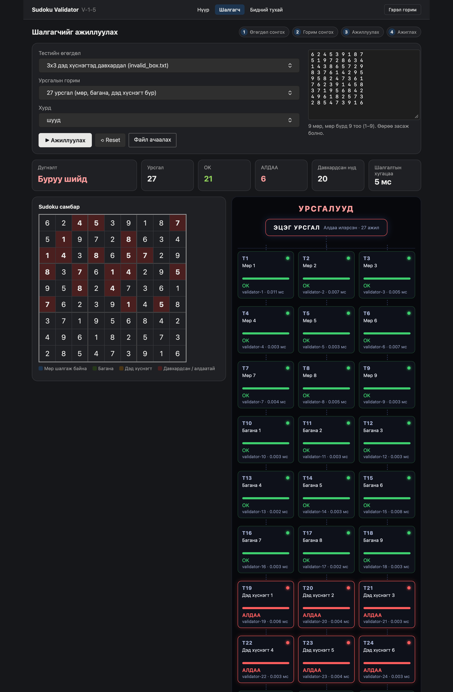
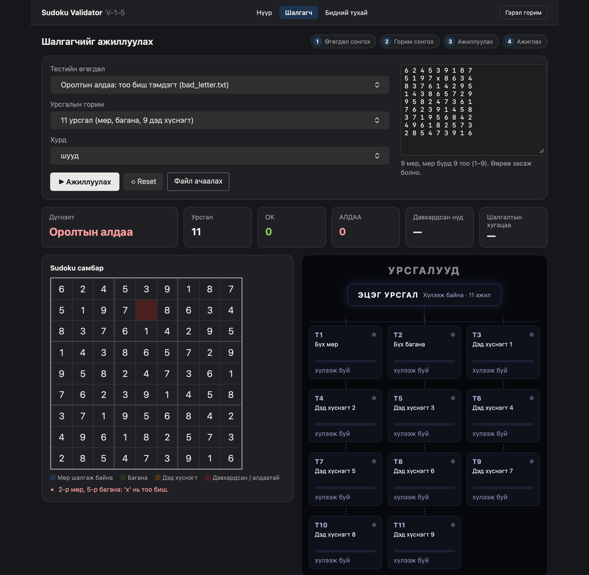

# F.CSM302 Үйлдлийн систем: Бие даалт 2. Final Report

**Хуваарилалтын код:** V-1-5
**Төсөл:** Sudoku Solution Validator (Operating System Concepts 2018, Бүлэг 4, Threads & Concurrency)
**Гишүүд:** О. Батцэцэг (B241940010); А. Пүрэвдэмбэрэл (B242270090); Г. Ундрам (B241910002); А. Дөлгөөн (B222270837); Т. Цэрэндулам (B241910025); Э. Өлзийсүрэн (B190910811)
**GitHub final release:** https://github.com/Baagii-dev/V-1-5-Sudoku-Solution-Validator/releases/latest

## Хураангуй
БД1-ээр хэрэгжүүлсэн Sudoku Solution Validator төслийг (Python threading, C POSIX Pthreads, онлайн React ба Web Worker) II-4-14 багийн албан ёсны шүүмжид тулгуурлан сайжруулсан. Нийт 8 санал (R1–R5, S1–S3) ирснээс 6-г бүрэн, 2-ыг хэсэгчлэн шийдвэрлэсэн. Хамгийн чухал нь Major түвшний R4: Reset-ийн дараа удаан ирсэн хуучин хариуг UI-д ашигладаг алдааг Python UI болон React хувилбарт зассан. Оролтын алдааны боловсруулалтыг (Unicode цифр, JSON бүтэц, CLI горим) сайжруулж, Python тестийг 11-ээс 18 болгосон. JavaScript 8 тест, C ба Python гаралтын тулгалт хэвээр тэнцсэн. Урсгалын тоо нэмэхэд шалгалтын хугацаа нэмэгддэгийг (1 урсгал 0.038 мс, 11 урсгал 0.368 мс, 27 урсгал 0.794 мс) хэмжиж баримтжуулсан.

## 1. Төслийн тойм
Сурах бичгийн Бүлэг 4-ийн Programming Project: 9×9 Sudoku-ийн шийд зөв эсэхийг мөр, багана, 3×3 дэд хүснэгт тус бүрээр олон урсгалаар шалгана. Эцэг урсгал хүснэгтийг параметрээр дамжуулж 11 урсгал (мөр 1, багана 1, дэд хүснэгт 9) эсвэл 27 урсгал (бүлэг бүрт тусдаа) үүсгэж, бүгдийг нь хүлээн (join) үр дүнг нэгтгэнэ. Урсгалууд `board`-ийг зөвхөн уншиж, үр дүнг өөр өөрийн нүдэнд бичдэг тул lock шаардлагагүй.

| Хувилбар | Технологи | Хаана |
|---|---|---|
| Python | `threading`, вэб UI сервер | `src/validator.py`, `src/app.py`, `src/ui.html` |
| C | POSIX Pthreads | `src/c/` |
| Онлайн | React, Vite, Web Worker, GitHub Pages | `web/` |

БД1-ийн үндсэн UI дүрслэл: Sudoku самбар болон "ЭЦЭГ УРСГАЛ"-аас урсгал бүрийн төлөв (хүлээж буй, ажиллаж байна, OK, АЛДАА) алхам алхмаар харагдана.

## 2. Эцсийн архитектур
Шүүмжийн дараа дараах бүрэлдэхүүн өөрчлөгдсөн. Урсгалын загвар, 11 ба 27 горим, C ба онлайн хувилбар өөрчлөгдөөгүй.

| Бүрэлдэхүүн | Файл | БД1 | Эцсийн |
|---|---|---|---|
| Оролтын уншигч | `src/sudoku_io.py` | `isdigit()` Unicode цифрийг (²) хүлээн авч, `int()` дээр унадаг | Зөвхөн ASCII цифр (`isascii()`), бусад нь "тоо биш" алдаа |
| API сервер | `src/app.py` | JSON бүтэц шалгадаггүй, сөрөг Content-Length шалгадаггүй | Объект биш JSON болон сөрөг Content-Length HTTP 400 |
| CLI | `src/validator.py` | `--mode=abc` дээр traceback | Usage мессеж, exit code 2 |
| Python UI | `src/ui.html` | Reset хийсэн ч удаан ирсэн хариу дэлгэцэнд гарна | `runId`-аар хуучин хариуг хаяна, "Шалгалтын хугацаа" шошго, "Үр дүнг тоглуулж байна…" төлөв |
| React UI | `web/src/pages/Validator.jsx` | Ижил асуудалтай | `runId` (`useRef`)-аар хуучин хариуг хаяна, ижил шошго, төлөв |

## 3. Туршилт ба дүрслэл
Хэрэглэгч тестийн өгөгдөл (8 файл), өөрийн 9×9 хүснэгт, 11 / 27 урсгалын горим, хурдыг сонгоно, самбарын нүдийг засаж болно. Ажиглах зүйл: урсгал бүрийн төлөв, давхардсан нүдийг улаанаар тэмдэглэсэн самбар, шалгалтын хугацаа. Дор байгаа зургууд нь эцсийн хувилбарын бодит дэлгэц (macOS, харанхуй горим).

## 4. Reviewer Responses
Эх сурвалж: II-4-14 багийн албан ёсны шүүмж (`II-4-14_Review_V-1-5.pdf`, Ubuntu 24.04, Python 3.12, GCC 13.3, Node 24; шалгасан commit `c69a576`). Teams дээрх манай БД1 постын доор 10-р сарын 30-ны байдлаар энэ шүүмжээс өөр албан ёсны шүүмж ирээгүй байсан.

| № | Шүүмж | Priority | Шийдвэр | Өөрчлөлт ба нотолгоо |
|---|---|---|---|---|
| R1 | `²` зэрэг Unicode цифр `isdigit()` давж, `int()` дээр унаж API хариу өгөхгүй | Minor | Зөвшөөрсөн | `sudoku_io.py`: `tok.isascii() and tok.isdigit()`. Commit `1114cfb`. Тест: `test_unicode_digits_rejected`, `test_unicode_digit_board_gets_400` |
| R2 | JSON root нь объект биш (`[]`, `null`) үед `AttributeError`, API хариугүй | Minor | Зөвшөөрсөн | `app.py`: `isinstance(payload, dict)`, сөрөг Content-Length шалгалт. Commit `1114cfb`. Тест: `test_non_object_json_gets_400`, `test_negative_content_length_gets_400` |
| R3 | `--mode=abc`, `--mode=12` дээр traceback | Minor | Зөвшөөрсөн (шүүмжийн `argparse` санал биш, одоо байгаа аргачлалаар) | `validator.py`: горимыг 11 / 27-той тулгаж usage мессеж, exit 2. Шалтгаан: шинэ dependency, бүтэц нэмэхгүйгээр ижил үр дүн. Commit `1114cfb`. Тест: `test_cli_bad_mode_exits_cleanly` |
| R4 | Reset, засварын дараа удаан ирсэн хуучин хариу UI-г сэргээнэ | **Major** | Зөвшөөрсөн | `ui.html`, `Validator.jsx`: `runId` нэмэгдүүлж хариуг шалгана. Commit `e6829b6`. Browser дээр хариуг 1.5 сек хоцруулж шалгасан (5-р хэсэг) |
| R5 | Report-ын Хавсралт А-д гишүүдийн ажлын хуваарилалт дутуу | Minor | Хэсэгчлэн | 2 гишүүний мөр (О. Батцэцэг, А. Пүрэвдэмбэрэл) commit, файлын нотолгоотой. Бусад 4 гишүүний ажлыг нотолгоогүйгээр зохиож бичихгүй, тэд ажлаа баримтжуулахаар үлдсэн (7-р хэсэг) |
| S1 | Бодит browser интеграцийн тест (Playwright г.м.) нэмэх | Suggestion | Хэсэгчлэн | R4-ийг browser дээр гараар, хариуг зориуд хоцроож хоёр UI дээр шалгасан (5-р хэсэг). Автомат browser тест нэмээгүй: ~150 MB browser татдаг dependency нь stdlib ба Node-оос өөр юм шаарддаггүй төслийн CI-д тохирохгүй, дараагийн шатанд үлдээв |
| S2 | UI-ийн хугацаа, "Үр дүнг алхам алхмаар тоглуулж байна" гэдгийг ялгах | Suggestion | Зөвшөөрсөн | "Нийт хугацаа" → "Шалгалтын хугацаа" (tooltip-тэй), тоглуулах үед "Үр дүнг тоглуулж байна…" төлөв. Commit `4ee4535`. Browser дээр шалгасан |
| S3 | Тайлангийн найруулга (урсгал өгөгдөл хуваалцахгүй гэх), PDF-ийн урт мөр тасрах | Suggestion | Зөвшөөрсөн | "Суралцсан зүйл" хэсгийг засав (урсгалууд `board`-ийг уншиж, үр дүнг тусдаа нүдэнд бичнэ). Шинэ PDF нь хүснэгт, мөрийг хуудсанд багтаан хуваана |

## 5. Дахин туршилт
Засварын өмнө commit `c69a576`, дараа `4ee4535` дээр ажиллуулсан.

| Тест | Засварын өмнө | Засварын дараа | Дүгнэлт |
|---|---|---|---|
| Python unit тест | 11 тэнцсэн | 18 тэнцсэн | Хуучин 11 тест эвдрээгүй, 7 шинэ тест нэмэгдсэн |
| Шинэ 5 тест хуучин кодод | 1 унасан, 4 алдаа | Бүгд тэнцсэн | Тест нь алдааг бодитоор илрүүлж байгаа нь батлагдсан |
| JavaScript тест (`npm test`) | 8/8 | 8/8 | Regression байхгүй |
| C ба Python гаралтын тулгалт (`make test`) | OK | OK | Бүх тестэд гаралт ижил |
| `npm run build` | Амжилттай | Амжилттай | |
| R4, React (хариуг 1.5 сек хоцруулж, Run, дараа нь Reset) | Дүгнэлт "Зөв шийд" буцаж гарсан | Дүгнэлт "—" хэвээр | Алдаа давтагдаж, засагдсан |
| R4, Python UI (адил нөхцөл, Run, Reset, засвар) | Давтаагүй (шүүмжлэгч jsdom-оор давтсан) | Дүгнэлт "—" хэвээр, хэвийн Run "Зөв шийд" | Засвар баталгаажсан |

Урсгалын тооны хэмжилт (Python 3.13, macOS arm64, `valid_book.txt`, 300 давталтын медиан):

| Горим | Хугацаа (мс) |
|---|---|
| 1 урсгал (дараалсан, урсгалгүй) | 0.038 |
| 11 урсгал | 0.368 |
| 27 урсгал | 0.794 |

Шалгах ажил маш жижиг (27 бүлэг × 9 нүд) тул урсгал үүсгэх зардал шалгалтаас давамгайлж, Python-ийн GIL-ээс болж урсгалууд бодитоор зэрэг ажилладаггүй. БД1-д олсон 0.33 / 0.71 мс-тэй ижил дүгнэлт (27 урсгал нь 11-ээс удаан).

## 6. Эцсийн үр дүн
| Үзүүлэлт | Утга |
|---|---|
| Python unit тест | 18 / 18 |
| JavaScript тест | 8 / 8 |
| C ба Python гаралтын тулгалт | Бүх тестэд ижил |
| Урсгалын горим | 11 ба 27, хоёулаа ижил дүгнэлттэй |
| Тестийн өгөгдөл | 8 файл (зөв, 4 буруу, 3 оролтын алдаа) |
| CI | Linux, macOS, Windows дээр Test; Pages; Release |
| Шүүмж | 8 санал: 6 бүрэн, 2 хэсэгчлэн шийдвэрлэсэн |

## 7. Хязгаарлалт
- Python-ийн GIL: олон урсгал хурд нэмэхгүй. Төсөл урсгалын загварыг (ажил хуваарилах, join, нэгтгэх) харуулах зорилготой.
- Онлайн хувилбарын Web Worker нь OS thread биш.
- C хувилбар Windows дээр зөвхөн WSL-ээр ажиллана.
- Автомат browser тест байхгүй (S1), R4-ийг гараар шалгасан.
- R5: 4 гишүүний хийсэн ажлыг нотолгоогүйгээр бичээгүй. Тэдний мэдээллийг нэмж баримтжуулна.
- Зөвхөн 9×9 хүснэгт, хоосон нүд (0) дэмжихгүй. Сервер зөвхөн локал.

## 8. Дүгнэлт
Шүүмж нь Major алдаа (R4) болон оролтын алдааны хэд хэдэн цоорхойг илрүүлсэн. Бүгдийг тест болон browser дээрх шалгалтаар баталгаажуулан зассан, регресс гараагүй. Үндсэн функц (11 ба 27 урсгалын шалгалт, C ба Python ижил гаралт, урсгалын дүрслэл) хадгалагдсан.

**Суралцсан зүйл**
- Асинхрон хариуг хаяхгүй бол UI хуучин төлөвт буцаж болдог. Хүсэлт бүрд ID өгч, хариуг одоогийн ID-тэй тулгана.
- Тест нь хуучин кодод унадаг эсэхийг нь шалгаж, нэмсэн тест алдааг үнэхээр илрүүлж байгааг баталгаажуулна.
- Шүүмжийн санал бүрийг шууд хэрэгжүүлэхгүй, зардал ба ашгийг нь тооцож (R3, S1) шийдвэр гаргана.

## Хавсралт A. Сайжруулалтын бүртгэл
| № | Шүүмж | Priority | Шийдвэр | Хийсэн өөрчлөлт | Нотолгоо |
|---|---|---|---|---|---|
| 1 | R4 хуучин хариу | Major | Зөвшөөрсөн | `runId`, хоёр UI | `e6829b6`, browser шалгалт |
| 2 | R1 Unicode цифр | Minor | Зөвшөөрсөн | `isascii()` | `1114cfb`, 2 тест |
| 3 | R2 JSON бүтэц | Minor | Зөвшөөрсөн | `isinstance`, Content-Length | `1114cfb`, 2 тест |
| 4 | R3 CLI горим | Minor | Зөвшөөрсөн | usage, exit 2 | `1114cfb`, 1 тест |
| 5 | S2 хугацаа | Suggestion | Зөвшөөрсөн | шошго, төлөв | `4ee4535` |
| 6 | R5, S1, S3 | Minor, Suggestion | Хэсэгчлэн / зөвшөөрсөн | 4-р хэсгийг үз | 4-р хэсэг |

| Тест | Засварын өмнө | Засварын дараа | Дүгнэлт |
|---|---|---|---|
| Python unit | 11 | 18 | Regression байхгүй |
| JavaScript | 8 | 8 | Хэвээр |
| C ба Python | Ижил | Ижил | Хэвээр |
| R4 React | Хуучин хариу буцна | Буцахгүй | Засагдсан |
