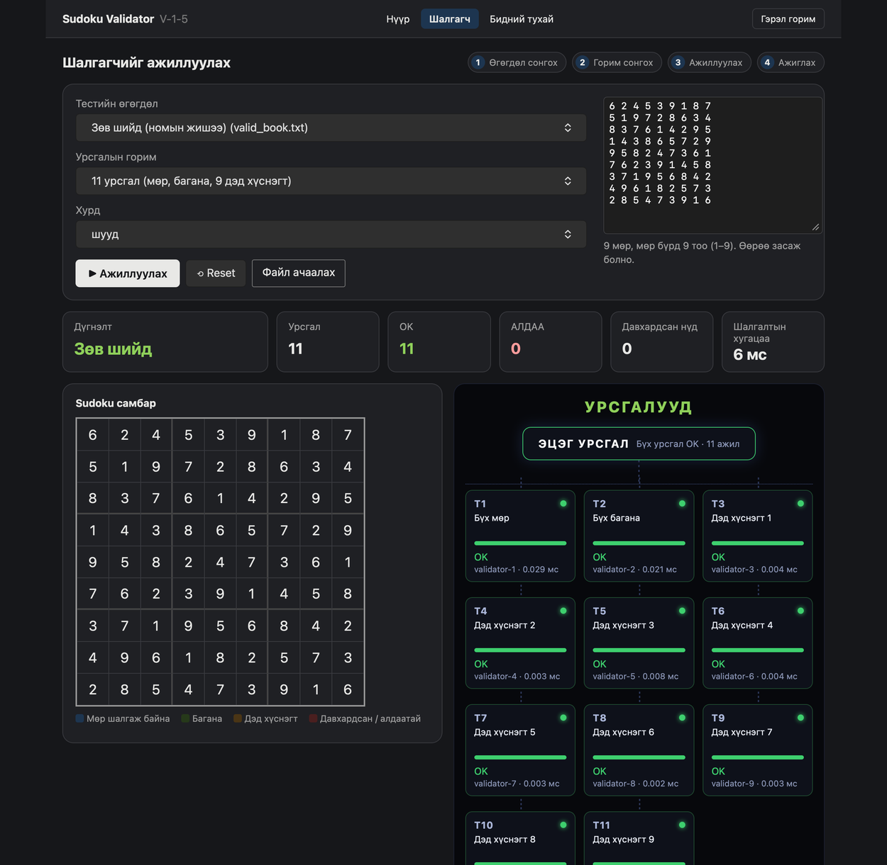
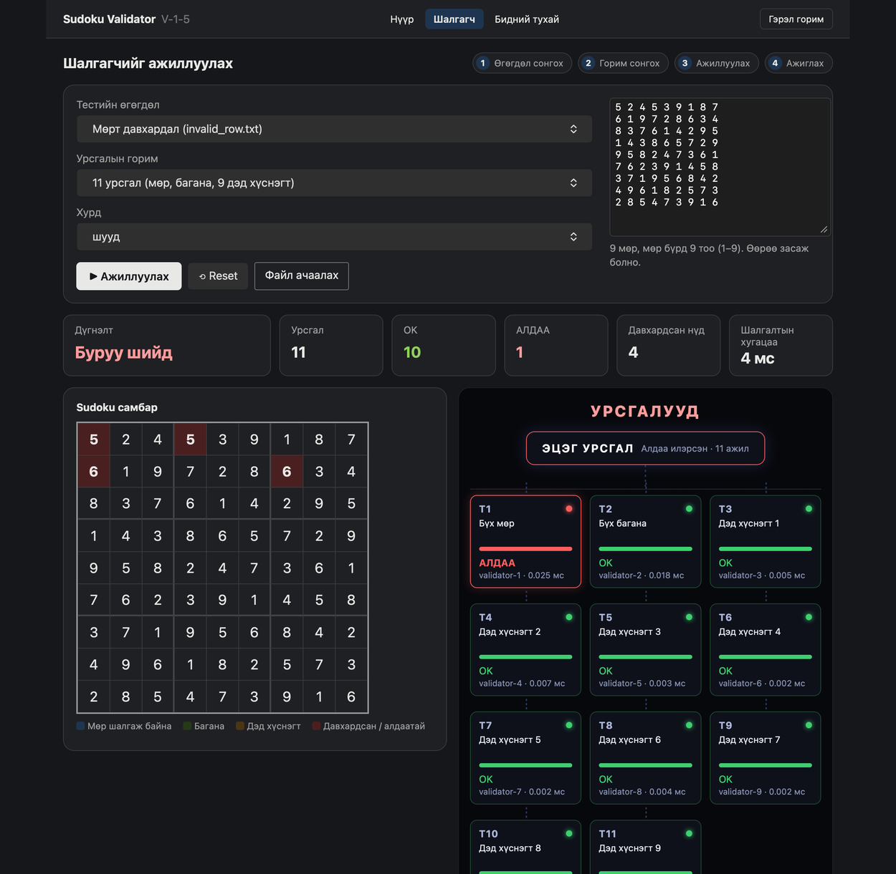
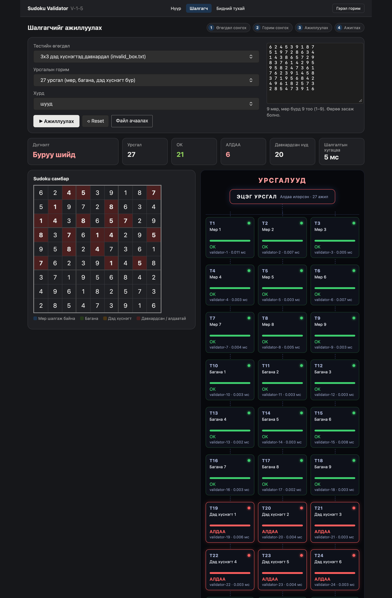
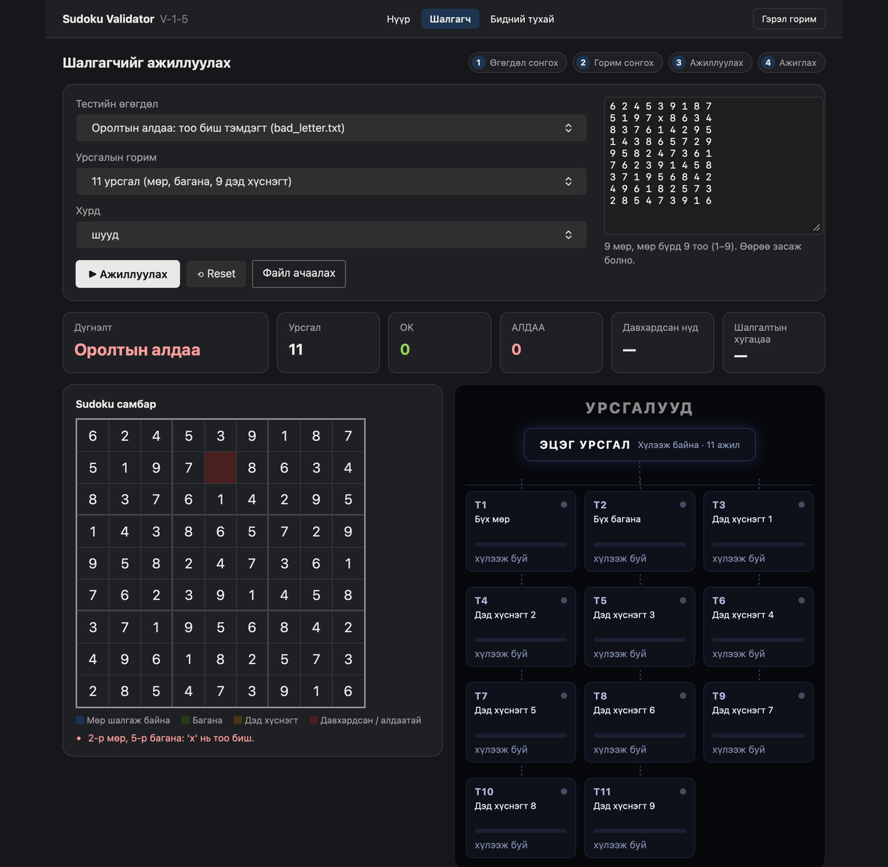

<div align="center" style="height:262mm;position:relative;text-align:center;font-family:'Times New Roman',Times,serif;color:#000;page-break-after:always">
<p align="center" style="margin:0 0 4px;font-size:12pt;font-weight:bold">ШИНЖЛЭХ УХААН, ТЕХНОЛОГИЙН ИХ СУРГУУЛЬ</p>
<p align="center" style="margin:0;font-size:12pt;font-weight:bold">МЭДЭЭЛЭЛ, ХОЛБООНЫ ТЕХНОЛОГИЙН СУРГУУЛЬ</p>
<p align="center" style="margin:28px 0 0"></p>
<p align="center" style="margin:70px 0 6px;font-size:34pt;font-weight:bold">Бие даалт 2. Гарын авлага</p>
<p align="center" style="margin:0;font-size:26pt;font-weight:bold">F.CSM302 Үйлдлийн систем</p>
<p align="center" style="margin:26px 0 0;font-size:12pt">2026-2027 оны хичээлийн жилийн намар</p>
<p align="center" style="margin:60px 0 0;font-size:12pt"><b>Сэдэв:</b> V-1-5 Sudoku Solution Validator (Threads &amp; Concurrency)</p>
<p align="center" style="margin:60px 0 0;font-size:12pt">Бэлтгэсэн: /................................../ О. Батцэцэг /B241940010/</p>
<p align="center" style="margin:22px 0 4px;font-size:12pt">Багийн гишүүд:</p>
<p align="center" style="margin:0;font-size:12pt">А. Пүрэвдэмбэрэл /B242270090/</p>
<p align="center" style="margin:0;font-size:12pt">Г. Ундрам /B241910002/</p>
<p align="center" style="margin:0;font-size:12pt">А. Дөлгөөн /B222270837/</p>
<p align="center" style="margin:0;font-size:12pt">Т. Цэрэндулам /B241910025/</p>
<p align="center" style="margin:0;font-size:12pt">Э. Өлзийсүрэн /B190910811/</p>
<p align="center" style="margin:22px 0 0;font-size:12pt">Шалгасан: /....................................../ Г. Ганбат /F.CS10/</p>
<div style="position:absolute;bottom:0;left:0;right:0">
<p align="center" style="margin:0;font-size:12pt">Улаанбаатар хот</p>
<p align="center" style="margin:4px 0 0;font-size:12pt">2026 он</p>
</div>
</div>

# V-1-5 Sudoku Solution Validator: Гарын авлага

## 1. Энэ програм юу хийдэг вэ
Програм 9×9 Sudoku хүснэгтийг шалгаад "Зөв шийд" эсвэл "Буруу шийд" гэж хэлнэ. Буруу бол давхардсан нүдийг улаанаар тэмдэглэнэ.

Шалгалтыг олон урсгал (thread) хийнэ. Мөр, багана, 3×3 дэд хүснэгт бүрийг тусдаа урсгал шалгаж, эцэг урсгал үр дүнг нэгтгэнэ. Нийт 11 урсгал, эсвэл 27 урсгалаар ажиллуулж болно. Програм гурван хувилбартай: **Python**, **C**, **онлайн**.

## 2. Хамгийн хялбар арга: онлайн
Хөтчөөр дараах хаягийг нээнэ. Юм суулгах шаардлагагүй.

https://baagii-dev.github.io/V-1-5-Sudoku-Solution-Validator/

## 3. Өөрийн компьютер дээр ажиллуулах

### 3.1 Юу хэрэгтэй вэ
| Зүйл | Хэзээ хэрэгтэй | Хувилбар |
|---|---|---|
| Git | Код татахад | Аль ч хувилбар |
| Python | Python хувилбар | 3.9 эсвэл түүнээс дээш (3.13.5 дээр туршсан). Гадны сан хэрэггүй |
| make ба cc (gcc эсвэл clang) | C хувилбар | macOS, Linux дээр |
| Node.js | Онлайн хувилбарын эх код | 22 (CI-д), 24 дээр ч ажилласан |
| Хөтөч | Вэб UI | Chromium-д суурилсан хөтөч эсвэл Safari |

Орчин: macOS 26.6.2 (arm64) дээр туршсан. Linux дээр CI-аар, Windows дээр CI-аар Python хувилбарыг шалгадаг.

### 3.2 Python хувилбар
```bash
git clone https://github.com/Baagii-dev/V-1-5-Sudoku-Solution-Validator.git
cd V-1-5-Sudoku-Solution-Validator
python3 src/app.py
```
Хөтөч өөрөө нээгдэнэ. Нээгдэхгүй бол `http://127.0.0.1:8000` хаягийг гараар нээнэ. Зогсоохдоо терминал дээр `Ctrl+C` дарна.

- Өөр порт: `python3 src/app.py --port=8001`
- Хөтөч нээхгүй: `python3 src/app.py --no-browser`
- Windows дээр `python3` олдохгүй бол `python` гэж бичнэ.

### 3.3 C хувилбар (Linux, macOS)
```bash
cd src/c
make
./validator --mode=11 ../../tests/valid_book.txt
./validator --mode=27 ../../tests/invalid_box.txt
```
Гаралт нь Python хувилбартай ижил. Оролт буруу бол `ОРОЛТЫН АЛДАА` гэж хэлээд мөр, баганыг заана. Windows дээр WSL (Ubuntu) дотор ажиллуулна.

### 3.4 Онлайн хувилбарын эх код
```bash
cd web
npm ci
npm run dev
```

## 4. Хэрхэн ашиглах вэ
Дээд талын цэсэнд гурван хуудас бий: **Нүүр** (тайлбар), **Шалгагч** (шалгалт ажиллуулах), **Бидний тухай** (баг, холбоос). Шалгагч хуудсанд дараах 4 алхмыг хийнэ.

1. **Өгөгдөл сонгоно.** "Тестийн өгөгдөл" жагсаалтаас файл сонгоно, эсвэл баруун талын талбарт өөрийн хүснэгтийг бичнэ. Файл ачаалж болно.
2. **Горим сонгоно.** 11 урсгал эсвэл 27 урсгал.
3. **Ажиллуулна.** "Ажиллуулах" товчийг дарна.
4. **Ажиглана.** Урсгал бүр `хүлээж буй` → `ажиллаж байна` → `OK` эсвэл `АЛДАА` болж өөрчлөгдөнө.

### 4.1 Удирдлага
| Удирдлага | Юу хийдэг |
|---|---|
| Тестийн өгөгдөл | `tests/` доторх файлыг сонгоно |
| Урсгалын горим | 11 эсвэл 27 урсгал |
| Хурд | удаан, дунд, хурдан, шууд |
| Файл ачаалах | Өөрийн `.txt` файл (9 мөр, мөр бүрд 9 тоо) |
| Текст талбар | Хүснэгтийг шууд засна. Тоог зай эсвэл таслалаар тусгаарлана |
| Самбарын нүд | Нүд дээр дарж тоо бичнэ. Текст талбар хамт шинэчлэгдэнэ |
| Reset | Дүрслэл, алдааг цэвэрлэнэ |
| Гэрэл / Харанхуй горим | Дээд баруун буланд. Анхны горим нь төхөөрөмжийн тохиргоотой ижил. Сонголтыг хөтөч хадгална |

Reset дарахад, оролт засахад өмнөх шалгалтын удаан ирсэн хариуг хаяна. Тиймээс хуучин дүгнэлт буцаж гарахгүй. Шалгалт дууссаны дараа алхмуудыг тоглуулах үед "Үр дүнг тоглуулж байна…" гэж харагдана.

### 4.2 Дэлгэц дээр юу харагдах вэ
- **Дээд талын картууд:** Дүгнэлт, Урсгал, OK, АЛДАА, Давхардсан нүд, Шалгалтын хугацаа (мс). Хугацаанд алхмуудыг тоглуулах хугацаа орохгүй.
- **Sudoku самбар:** Шалгаж буй бүлэг өнгөөр тодорно. Давхардсан нүд улаан болно.
- **УРСГАЛУУД:** Дээд талд "ЭЦЭГ УРСГАЛ", доор урсгал бүрийн карт. Карт бүр нэр, төлөв, хугацааг (мс) харуулна.

| Өнгө | Утга |
|---|---|
| Цэнхэр | Мөр шалгаж байна |
| Ногоон | Багана шалгаж байна |
| Шар | Дэд хүснэгт шалгаж байна |
| Улаан дэвсгэр | Давхардсан утга |
| Улаан хүрээ | Оролтын алдаа (тоо биш, 1–9-өөс гадуур) |

### 4.3 Жишээ
**Жишээ 1: зөв шийд.** `valid_book.txt` сонгоод "Ажиллуулах" дарна. 11 урсгал бүгд `OK`, дүгнэлт "Зөв шийд".



**Жишээ 2: мөрийн алдаа.** `invalid_row.txt` сонгоно. `T1 Бүх мөр` урсгал `АЛДАА` болж, 1-р мөрийн (1,1), (1,4) нүд болон 2-р мөрийн (2,1), (2,7) нүд улаан болно.



**Жишээ 3: 27 урсгал.** `invalid_box.txt` сонгож, горимыг "27 урсгал" болгоно. Дэд хүснэгтийн урсгалууд (T19–T24) `АЛДАА` болж, 6 АЛДАА, 20 давхардсан нүд гарна.



**Жишээ 4: оролтын алдаа.** `bad_letter.txt` сонгоно. Дүгнэлт "Оролтын алдаа" болж, `2-р мөр, 5-р багана: 'x' нь тоо биш.` гэсэн мессеж гарна.



Холбоосоор шууд нээж болно: `http://127.0.0.1:8000/?sample=invalid_row.txt&mode=11&autorun=1`. Онлайн хувилбарт: `https://baagii-dev.github.io/V-1-5-Sudoku-Solution-Validator/?sample=invalid_row.txt&mode=11&autorun=1`

## 5. Алдаа гарвал
| Мессеж эсвэл байдал | Шалтгаан | Яах вэ |
|---|---|---|
| `9 мөр байх ёстой, N мөр байна.` | Мөрийн тоо буруу | 9 мөр болгоно |
| `N-р мөрөнд 9 утга байх ёстой` | Мөрийн утгын тоо буруу | Дутуу эсвэл илүү утгыг засна |
| `'x' нь тоо биш.` | Тоо биш тэмдэгт | Тоогоор солино |
| `0 нь 1–9 хооронд биш.` | Утга муж хэтэрсэн | 1–9 хооронд бичнэ |
| `Сервертэй холбогдож чадсангүй` | Сервер ажиллахгүй байна | `python3 src/app.py` ажиллуулна |
| `8000-р порт эзлэгдсэн байна` | Порт өөр програмд эзлэгдсэн | `--port=8001` гэх мэт өөр порт сонгоно |
| Урсгал "хүлээж буй" хэвээр | Ажиллуулах товч дарагдаагүй | "Ажиллуулах" дарна |
| `--mode нь 11 эсвэл 27 байх ёстой` | Командын мөрөнд буруу `--mode` | `--mode=11` эсвэл `--mode=27` бичнэ |
| `Хүсэлт буруу: JSON нь объект байх ёстой.` | API руу объект биш JSON явуулсан | `{"board": "...", "mode": 11}` хэлбэрээр явуулна |

## 6. Тест ажиллуулах
```bash
python3 tests/test_validator.py        # Python тест
cd web && npm test                      # JavaScript тест
cd src/c && make test                   # C ба Python гаралтыг тулгах
python3 src/validator.py tests/valid_book.txt
python3 src/validator.py --mode=27 tests/invalid_box.txt
```

Амжилттай бол дараах мөрүүд гарна:
- Python: `Ran 18 tests ... OK`
- JavaScript: `tests 8, pass 8, fail 0`
- C: `OK: C ба Python бүх тестэд ижил гаралттай`

## 7. Тестийн файлууд (`tests/`)
| Файл | Хүлээгдэх үр дүн |
|---|---|
| `valid_book.txt` | Зөв шийд, бүх урсгал OK |
| `invalid_row.txt` | Буруу. Мөрийн урсгал алдаатай |
| `invalid_col.txt` | Буруу. Баганын урсгал алдаатай |
| `invalid_box.txt` | Буруу. Дэд хүснэгтийн урсгалууд алдаатай |
| `invalid_cell.txt` | Буруу. Нэг нүдний утга мөр, багана, дэд хүснэгтэд зэрэг давхардана |
| `bad_letter.txt` | `2-р мөр, 5-р багана: 'x' нь тоо биш.` |
| `bad_range.txt` | `4-р мөр, 5-р багана: 0 ...`, `6-р мөр, 9-р багана: 10 ...` |
| `bad_short.txt` | `9 мөр байх ёстой, 8 мөр байна.` |

## 8. Мэдэх хэрэгтэй хязгаарлалт
- Python-ийн GIL-ээс болж урсгалууд жинхэнэ зэрэг тооцоолдоггүй. Хурд нэмэгдэхгүй, зөв ажиллагаанд нөлөөлөхгүй.
- Онлайн хувилбарын урсгал нь хөтчийн Web Worker, үйлдлийн системийн thread биш.
- Сервер зөвхөн `127.0.0.1` дээр ажиллана.
- Windows дээр C хувилбар зөвхөн WSL (Ubuntu) дотор ажиллана.
- Автомат browser тест байхгүй. Reset-ийн засварыг browser дээр гараар шалгасан.

## 9. Final хувилбарт юу өөрчлөгдсөн
| Өөрчлөлт | Хэрэглэгчид юу өөрчлөгдсөн |
|---|---|
| Reset-ийн дараах хуучин хариуг хаасан | Reset, засвар хийсний дараа өмнөх дүгнэлт буцаж гарахгүй |
| Unicode цифр (`²` г.м.) | "тоо биш" гэсэн оролтын алдаа гарна, API унахгүй |
| API-ийн буруу хүсэлт | Объект биш JSON-д HTTP 400 ба тайлбар |
| `--mode` шалгалт | Буруу `--mode` дээр usage мессеж, гарах код 2 |
| Хугацааны шошго | "Нийт хугацаа" → "Шалгалтын хугацаа"; тоглуулах үед "Үр дүнг тоглуулж байна…" |
| Гэрэл / Харанхуй горим | Python UI болон онлайн хувилбарт товч нэмэгдсэн |
| README | macOS, Linux, Windows бүрийн суулгах, ажиллуулах команд |
