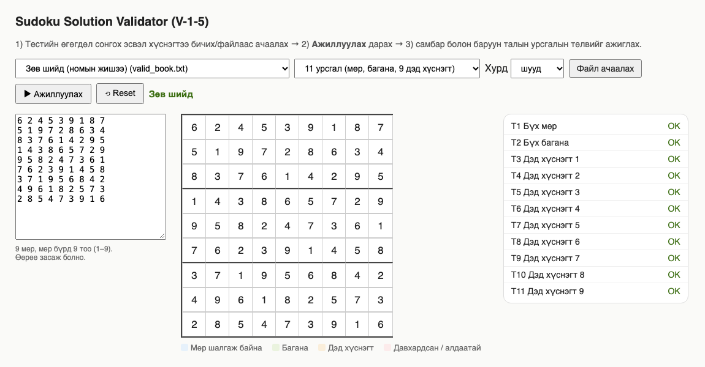
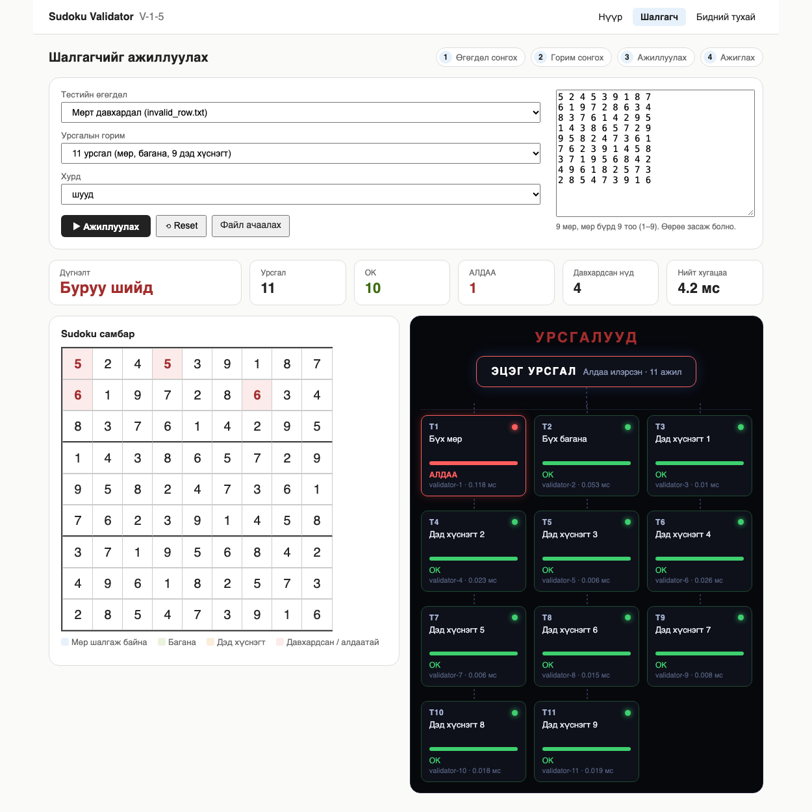
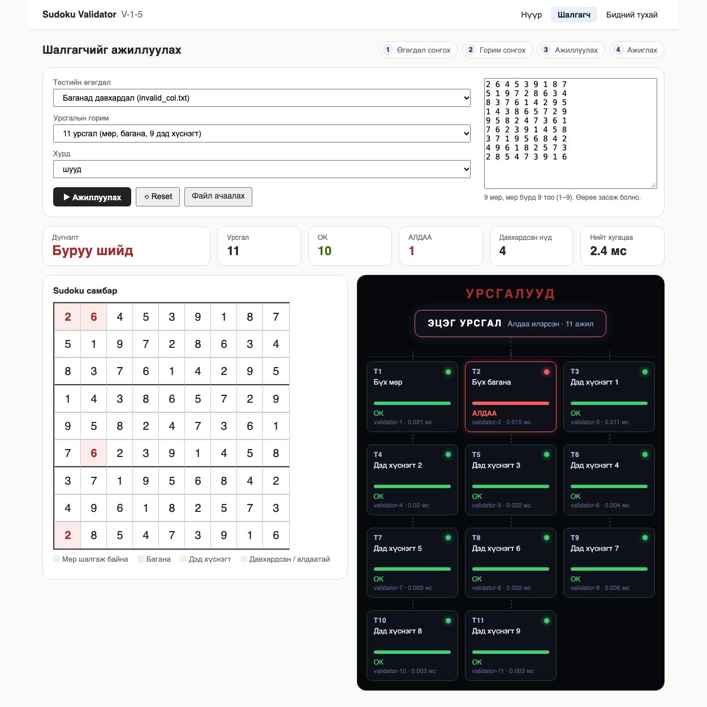
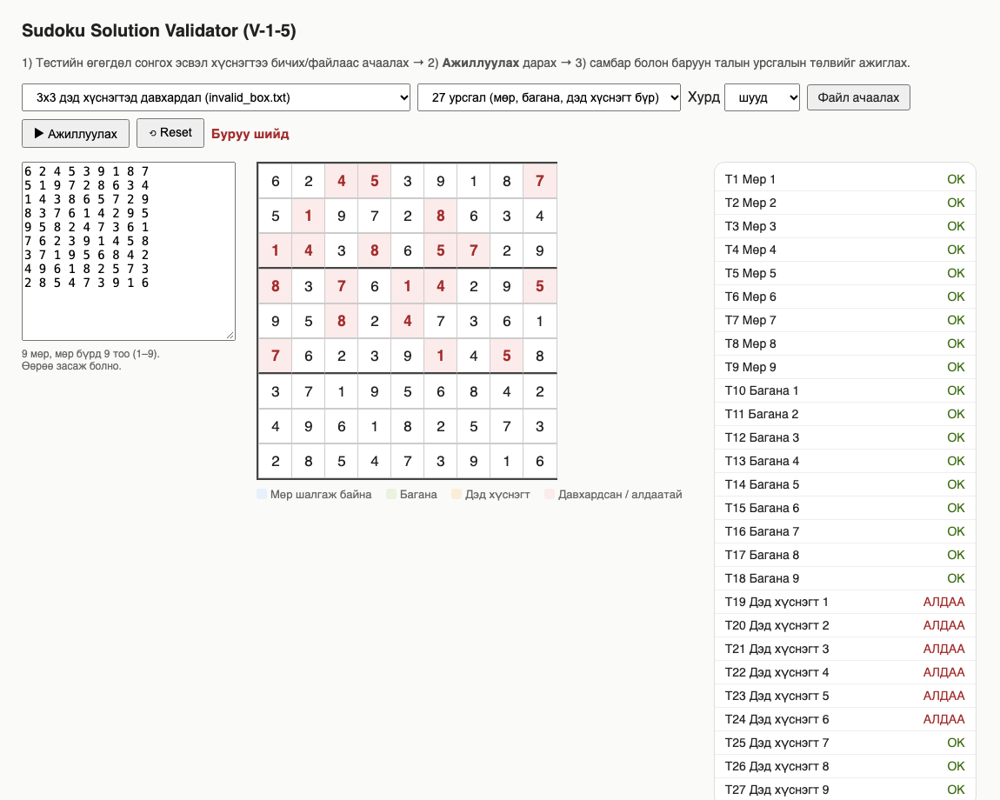
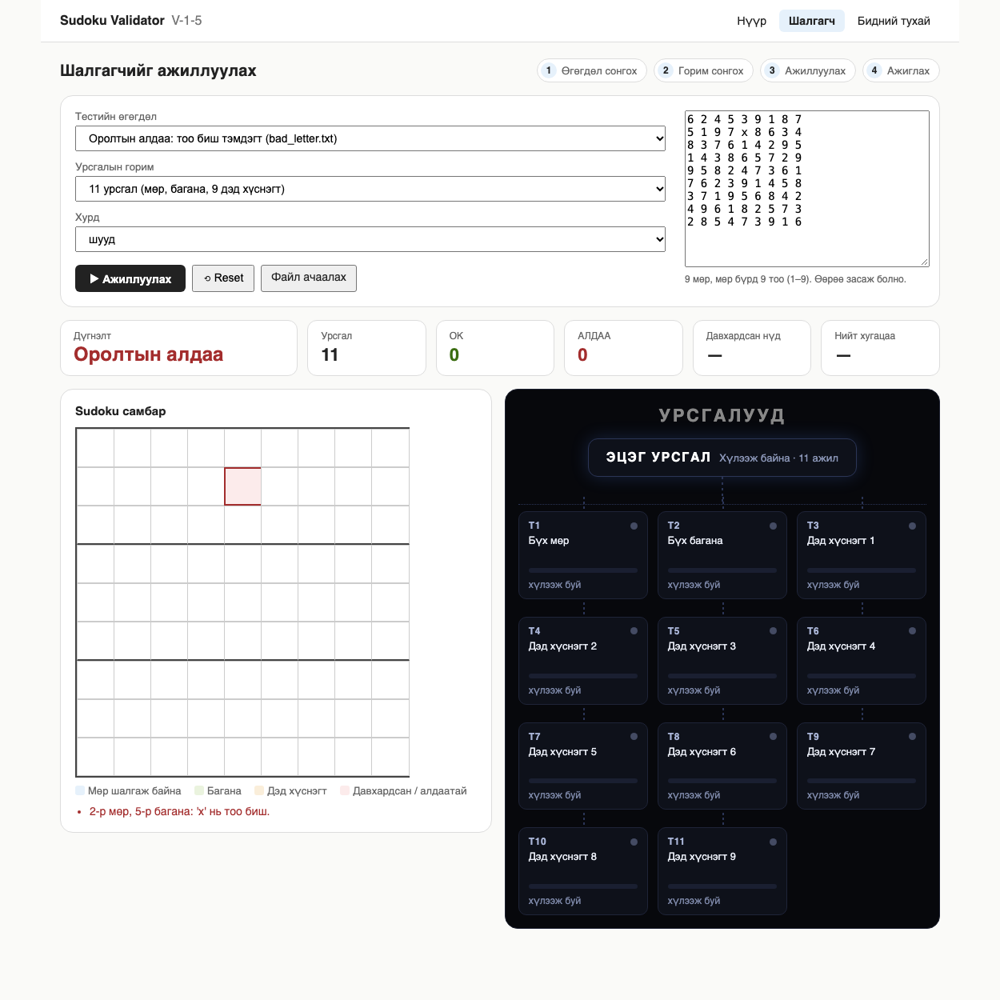

# F.CSM302 Үйлдлийн систем: Бие даалт 1. Тайлан

**Хуваарилалтын код:** V-1-5
**Төсөл:** Sudoku Solution Validator (Operating System Concepts 2018, Бүлэг 4, Threads & Concurrency)
**Гишүүд:** О.Батцэцэг (B241940010); А.Пүрэвдэмбэрэл (B242270090); Undram Ganjiguur (B241910002); Dulguun Ariunbayr (B222270837); Tserendulam Tuvshinjargal (B241910025); Ulziisuren Erdenetugs (B190910811)  
**GitHub:** https://github.com/Baagii-dev/V-1-5-Sudoku-Solution-Validator


## Хураангуй
9x9 Sudoku хүснэгтийн шийд зөв эсэхийг олон урсгалаар шалгах программыг Python дээр хэрэгжүүлсэн. Мөр, багана, 3x3 дэд хүснэгтийг тусдаа урсгал шалгаж, эцэг урсгал үр дүнг нэгтгэнэ. Вэб UI нь Sudoku самбар дээр урсгал бүрийн шалгалтыг ялган харуулдаг. Нэмж, татах шаардлагагүй онлайн хувилбарыг React болон Web Worker ашиглан хэрэгжүүлж GitHub Pages дээр байршуулсан. 5 тестийн өгөгдөл, 3 буруу оролтын тест, Python-ы 11 unit тест, JavaScript-ийн 6 тест ашиглан зөв ажиллагааг нотолсон.

## 1. Удиртгал
Олон урсгалт програмчлал нь өгөгдөл хуваалцах, үр дүн нэгтгэх зэрэг OS-ийн урсгалын үндсэн ойлголтыг шаарддаг. Sudoku шийдийн шалгалт нь бие даасан гурван төрлийн шалгалтад задарч, урсгалд ажил хуваарилах ойлголтыг энгийнээр харуулдаг. Хамрах хүрээ: 9x9 хүснэгт, давхардал шалгах. Sudoku-г бодох (solver) хамаарахгүй.

## 2. Сурах бичгийн шаардлага
- Мөр бүрийг шалгах нэг урсгал, багана бүрийг шалгах нэг урсгал.
- 3x3 дэд хүснэгт бүрийг шалгах есөн урсгал (нийт 11 урсгал).
- Эцэг урсгал хүснэгтийн мэдээллийг параметрээр дамжуулж, бүх урсгалыг хүлээн (join) үр дүнг нэгтгэнэ.
- Сонголт: мөр, багана, дэд хүснэгт бүрт тусдаа урсгал (27 урсгал). Манай хэрэгжилт хоёр горимыг хоёуланг нь дэмжинэ.

## 3. Онолын үндэс
- **Урсгал (thread):** процессын дотор нэг хаяг орон зай, өгөгдлийг хуваалцан ажилладаг гүйцэтгэлийн нэгж.
- **Өгөгдөл хуваалцах:** урсгалууд `board`-ийг зөвхөн **уншина**. Үр дүнг бичихдээ тус бүр жагсаалтын **өөрийн нүдэнд** бичдэг тул race condition үүсэхгүй, lock хэрэггүй.
- **Fork-join загвар:** эцэг урсгал `start()`, дараа нь `join()` хийнэ.
- **Алгоритм:** бүлэг (мөр, багана, дэд хүснэгт) бүрийн 9 утгад давхардал байгаа эсэхийг тоолно. Хугацааны нарийвчлал O(9) бүлэг тутамд.
- **Python-ы GIL:** CPython-д Global Interpreter Lock нь нэг дор зөвхөн нэг урсгалыг Python код ажиллуулахыг зөвшөөрдөг. Иймд I/O-bound ажилд (сүлжээ, файл хүлээх) урсгал ашигтай боловч CPU-bound тооцоололд (манай шалгалт шиг) урсгалууд жинхэнэ зэрэгцээ ажиллахгүй, хурд нэмэгдэхгүй. Энэ төсөл нь хурд биш, урсгалын загвар (fork-join, ажил хуваарилалт, үр дүн нэгтгэх) харуулах зорилготой тул GIL нь зөв ажиллагаанд нөлөөлөхгүй.

## 4. Системийн зохиомж
Вэб UI нь гурван хуудастай: **Нүүр** (даалгаврын тайлбар), **Шалгагч** (шалгалтыг ажиллуулж урсгалыг диаграмаар харах), **Бидний тухай** (баг, тоон үзүүлэлт, холбоос). Хоёр хувилбарт ижил бүтэцтэй.

Төсөл гурван хувилбартай (Python, C, онлайн). **Python хувилбар** (`src/`) нь үйлдлийн системийн жинхэнэ урсгал (`threading`) ашигладаг. **C хувилбар** (`src/c/`) нь сурах бичгийн Pthreads загвартай ижил, POSIX урсгал ашигласан хэрэгжүүлэлт юм. **Онлайн хувилбар** (`web/`) нь шалгалтын ижил логикийг JavaScript-ээр бичиж, урсгал болгон хөтчийн **Web Worker** ашигладаг. Web Worker нь хөтчийн удирддаг тусдаа гүйцэтгэлийн урсгал бөгөөд OS-ийн thread-ээс өөр түвшинд ажилладаг тул онлайн хувилбарыг OS урсгалтай ижил гэж үзэхгүй. Гурвуулаа ижил 11 ба 27 урсгалын ажлын хуваарилалттай бөгөөд нийт ижил `tests/*.txt` өгөгдөлд ижил дүгнэлт гаргадаг.

### 4.1 Python хувилбар
```
Хөтөч (ui.html) --POST /api/validate--> app.py --parse_board--> sudoku_io.py
                                          |
                                          v
                                   validator.validate()
                         эцэг урсгал: 11 эсвэл 27 урсгал үүсгэж join
                                          |
                   JSON үр дүн (урсгал бүрийн ok, давхардсан нүднүүд)
                                          v
                     ui.html: алхам алхмаар тоглуулж самбар дээр харуулна
```
| Компонент | Файл | Үүрэг |
|---|---|---|
| Оролтын уншигч | `src/sudoku_io.py` | Файл эсвэл текстийг уншиж, алдаа бүрийн мөр, баганыг цуглуулна |
| Validator | `src/validator.py` | Ажил үүсгэх, урсгал ажиллуулах, нэгтгэх |
| Сервер | `src/app.py` | UI үйлчилж, `/api/validate`, `/api/samples` өгнө |
| UI | `src/ui.html` | Самбар, урсгалын төлөв, legend |

### 4.2 C хувилбар (Pthreads)
`src/c/validator.c` нь сурах бичгийн Programming Project-д тулгуурласан POSIX Pthreads хэрэгжүүлэлт юм. Эцэг урсгал `pthread_create`-ээр 11 эсвэл 27 урсгал үүсгэж, `pthread_join`-оор хүлээнэ. Урсгал бүр `board`-ийг зөвхөн уншиж, үр дүнгээ өөрийн `Task` бүтцэд бичдэг тул mutex шаардахгүй. Python-ы GIL-ээс ялгаатай нь C хувилбарын урсгалууд олон цөм дээр жинхэнэ зэрэгцээ ажиллах боломжтой. Гаралт нь Python хувилбартай тэмдэгт хүртэл ижил бөгөөд `make test` нь 2 горим, 8 тестийн файл, 5 захын тохиолдол дээр хоёрыг харьцуулдаг. Мөн AddressSanitizer, UndefinedBehaviorSanitizer, ThreadSanitizer-ээр шалгахад алдаа гараагүй.

### 4.3 Онлайн (React) хувилбар
```
React UI (App.jsx) --parseBoard--> validate(board, mode)
                                        |  ажил бүрт Web Worker үүсгэнэ
                                        v
              worker.js (runTask) x 11 эсвэл 27 --> Promise.all-аар нэгтгэнэ
                                        v
              App.jsx: алхам алхмаар тоглуулж самбар болон урсгалын жагсаалтад харуулна
```
| Компонент | Файл | Үүрэг |
|---|---|---|
| Оролтын уншигч | `web/src/core/parseBoard.js` | `sudoku_io.py`-ийн адил, BOM ба CRLF дэмжинэ |
| Ажил, шалгалт | `web/src/core/tasks.js` | `build_tasks`, бүлэг шалгах `checkGroup`, `runTask` |
| Эцэг урсгал | `web/src/core/validate.js` | Ажил бүрт Worker үүсгэж үр дүнг нэгтгэнэ |
| Урсгал | `web/src/core/worker.js` | Нэг ажлыг гүйцэтгэж үр дүнг буцаана |
| UI | `web/src/App.jsx`, `components/` | Самбар, урсгалын төлөв, удирдлага |

## 5. Хэрэгжилт
- Хэл: Python 3.13, сан: зөвхөн стандарт (`threading`, `http.server`, `json`, `unittest`).
- `build_tasks(mode)` нь горимоор нь `Task` жагсаалт үүсгэнэ. `Task` нь шалгах бүлгүүдийн жагсаалт агуулна.
- `_worker` нь урсгал бүрт ажиллаж, бүлэг бүрийн давхардсан нүднүүдийг олж, үр дүнг `results[slot]`-д бичнэ.
- `validate(board, mode)` нь урсгалуудыг эхлүүлж, `join` хийж, нэгтгэсэн `valid` дүгнэлтийг буцаана.
- Оролтын алдаа (тоо биш, муж хэтэрсэн, мөр дутуу) нь `SudokuInputError` болж, UI-д алдаатай нүдийг тодруулна.
- Онлайн хувилбар: React 19, Vite 8. `validate()` нь ажил бүрт `new Worker(...)` үүсгэж, `Promise.all`-аар хүлээж, нэгтгэсэн дүгнэлт буцаана. Тестийн өгөгдлийг build хийхэд багтаасан тул сервер хэрэггүй. GitHub Actions нь build хийж GitHub Pages руу байршуулна.
- Анхаарах: GIL-ийн улмаас урсгалууд жинхэнэ зэрэгцээ тооцоолохгүй. Энэ хэрэгжилт нь зөв ажиллагаа, урсгалын загварыг харуулах зорилготой.

## 6. Туршилт ба UI дүрслэл
Юуг өөрчилж турших:
- Тестийн өгөгдөл сонгох эсвэл хүснэгтийг текст талбарт засах.
- 11 ба 27 урсгалын горим солих.
- Хурд сонгож алхмуудыг ажиглах.

Юуг ажиглах: самбар дээр шалгаж буй бүлэг өнгөөр тодорч (цэнхэр, ногоон, шар), давхардсан утга улаан болно. Самбарын доор урсгалын диаграм байрлах бөгөөд "ЭЦЭГ УРСГАЛ"-аас карт болгон урсгал бүрийн төлөв `хүлээж буй → ажиллаж байна → OK/АЛДАА` өөрчлөгдөнө. Дээд талын тоон картууд дүгнэлт, OK ба АЛДАА-тай урсгалын тоо, давхардсан нүдний тоо, нийт хугацааг харуулна. Дүрслэл нь сервер дээрх бодит урсгалын үр дүнг тоглуулдаг. Өнгө, тэмдэглэгээг самбарын доорх legend тайлбарлана.

## 7. Туршилтын арга
- Орчин: macOS 26.6.2 (arm64), Python 3.13.5, Chrome 155.
- Өгөгдөл: `tests/` дотор 8 файл. Хүлээгдсэн үр дүнг Manual-ын 2.5, 2.6 хэсгээс үзнэ.
- Автомат: `python3 tests/test_validator.py` (11 unit тест), `cd web && npm test` (6 тест, Node 22).
- CI: GitHub Actions-ийн Test workflow нь Python тестийг Ubuntu, Windows, macOS дээр, JavaScript тестийг Ubuntu дээр ажиллуулна.
- Командын мөр: `python3 src/validator.py tests/*.txt`.

## 8. Үр дүн
| Тест | Оролт | Хүлээгдсэн | Бодит |
|---|---|---|---|
| 1 | `valid_book.txt` | Зөв шийд | Зөв шийд, 11 урсгал OK |
| 2 | `invalid_row.txt` | Мөрийн алдаа | T1 АЛДАА, мөр 1 (1,1)(1,4), мөр 2 (2,1)(2,7) |
| 3 | `invalid_col.txt` | Баганын алдаа | T2 АЛДАА, багана 1 (1,1)(9,1), багана 2 (1,2)(6,2) |
| 4 | `invalid_box.txt` | Дэд хүснэгтийн алдаа | T3–T8 АЛДАА (6 дэд хүснэгт) |
| 5 | `invalid_cell.txt` | Нэг нүдний давхардал | Мөр 1, багана 1, дэд хүснэгт 1 зэрэг АЛДАА |
| 6 | `bad_letter.txt` | Оролтын алдаа | `2-р мөр, 5-р багана: 'x' нь тоо биш.` |
| 7 | `bad_range.txt` | Оролтын алдаа | 0 ба 10 хоёр утгыг заасан |
| 8 | `bad_short.txt` | Оролтын алдаа | `9 мөр байх ёстой, 8 мөр байна.` |
| 9 | 11 ба 27 горим | Адил дүгнэлт | `test_modes_agree` OK |
| 10 | Python unit тест | 11/11 | `Ran 11 tests ... OK` |
| 11 | JavaScript тест | 6/6 | `tests 6, pass 6` |

Дэлгэцийн зураг:







## 9. Хэлэлцүүлэг
- 11 ба 27 урсгалын горим нэг дүгнэлт өгдөг (тестээр нотолсон).
- **Хугацааны хэмжилт (Python):** `valid_book.txt`-ийг 300 удаа шалгаж median-ийг авахад 11 урсгалтай горим ойролцоогоор 0.33 мс, 27 урсгалтай горим ойролцоогоор 0.71 мс байв (macOS arm64, Python 3.13.5). 27 урсгалтай нь илүү удаан нь шалгах ажил маш бага тул урсгал үүсгэх зардал давамгайлдагтай холбоотой. Өгөгдөл жижиг, GIL байгаа тул олон урсгал хурдыг сайжруулаагүй.
- Хязгаарлалт: GIL (Python хувилбар); онлайн хувилбарын урсгал нь OS thread биш, хөтчийн Web Worker; зөвхөн 9x9; хоосон нүд (0) дэмжихгүй, 1–9 л зөвшөөрнө; сервер зөвхөн локал.


## 10. Дүгнэлт
Номын шаардлагын дагуу 11 урсгалтай (болон 27 урсгалтай) validator хэрэгжүүлж, бодит урсгалтай холбогдсон Sudoku самбар UI-тай болгосон. Зөв, буруу, захын оролтыг тестээр нотолсон.
## GitHub дахь багийн ажиллагаа
Эх код нь анхнаасаа GitHub репозиторид (https://github.com/Baagii-dev/V-1-5-Sudoku-Solution-Validator) хөтлөгдсөн. 2026-10-09-ээс 2026-10-26 хүртэл нийт 42 commit хийгдсэн бөгөөд бүгд B241940010 гишүүний git акаунтаас орсон. Commit-уудыг Conventional Commits загвараар (`fix:`) бичсэн.

| Зүйл | Тайлбар |
|---|---|
| CI: Test | Push бүрт Python тестийг Ubuntu, Windows, macOS дээр, C хувилбарыг Ubuntu, macOS дээр, JavaScript тестийг Node 22 дээр автоматаар ажиллуулна |
| CI: Pages | `web/` хавтсыг build хийж GitHub Pages дээр байршуулна (онлайн хувилбар) |
| CI: Release | `semantic-release` нь commit-оос release tag (`v1.0.x`) болон release note үүсгэнэ |
| Хамгаалалт | Workflow-ийн action бүрийг commit SHA-аар тогтоосон, зөвхөн шаардлагатай эрхтэй |

## Ашигласан материал
- Silberschatz, Galvin, Gagne. *Operating System Concepts* (2018), Бүлэг 4, Programming Projects.
- Python 3 documentation: `threading`, `http.server`.
- AI: Claude Code (Anthropic) нь Python validator, вэб UI, онлайн (React) хувилбар, тест, GitHub Actions тохиргоо, баримтын эхийг бичихэд ашиглагдсан. Дэлгэрэнгүйг README-ээс үзнэ.

## Хавсралт A. Ажлын төлөвлөгөө
| Талбар | Мэдээлэл |
|---|---|
| Хуваарилалтын код | V-1-5 |
| Төсөл | Sudoku Solution Validator |
| Repository | https://github.com/Baagii-dev/V-1-5-Sudoku-Solution-Validator |
| Хэл/сан/орчин | Python 3.13 (стандарт сан); онлайн хувилбар: JavaScript, React, Vite; macOS, Windows, Linux |
| Үндсэн дүрслэл | Sudoku board |

| Гишүүн | Хариуцах ажил | Commit/file |
|---|---|---|
| B241940010 О.Батцэцэг | | |
| B242270090 А.Пүрэвдэмбэрэл | | |
| B241910002 Undram Ganjiguur | | |
| B222270837 Dulguun Ariunbayr | | |
| B241910025 Tserendulam Tuvshinjargal | | |
| B190910811 Ulziisuren Erdenetugs | | |

| Тест | Оролт/нөхцөл | Хүлээгдсэн үр дүн |
|---|---|---|
| 1 | `valid_book.txt`, 11 ба 27 урсгал | Зөв шийд, бүх урсгал OK |
| 2 | `invalid_row.txt` | Буруу шийд, мөрийн урсгал АЛДАА |
| 3 | `invalid_col.txt` | Буруу шийд, баганын урсгал АЛДАА |
| 4 | `invalid_box.txt` | Буруу шийд, дэд хүснэгтийн урсгалууд АЛДАА |
| 5 | `invalid_cell.txt` | Нэг нүд мөр, багана, дэд хүснэгтэд зэрэг буруу |
| 6 | `bad_letter.txt`, `bad_range.txt`, `bad_short.txt` | Оролтын алдаа, мөр ба баганыг заасан мессеж |
| 7 | BOM ба CRLF-тэй файл | Зөв уншигдаж, шийд зөв гэж дүгнэнэ |
| 8 | 11 ба 27 горимыг харьцуулах | Хоёр горим ижил дүгнэлт гаргана |
